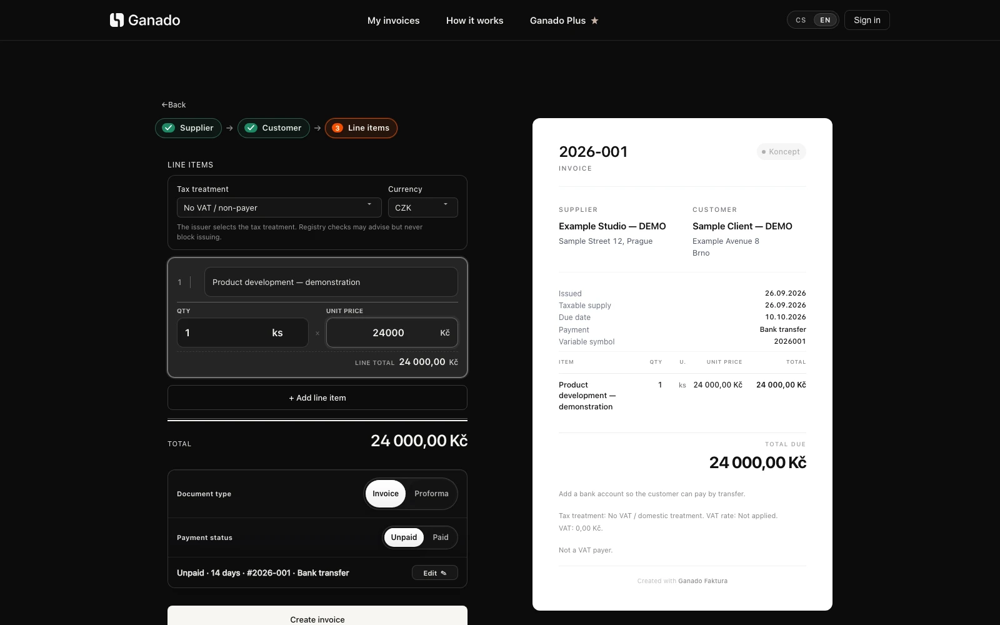
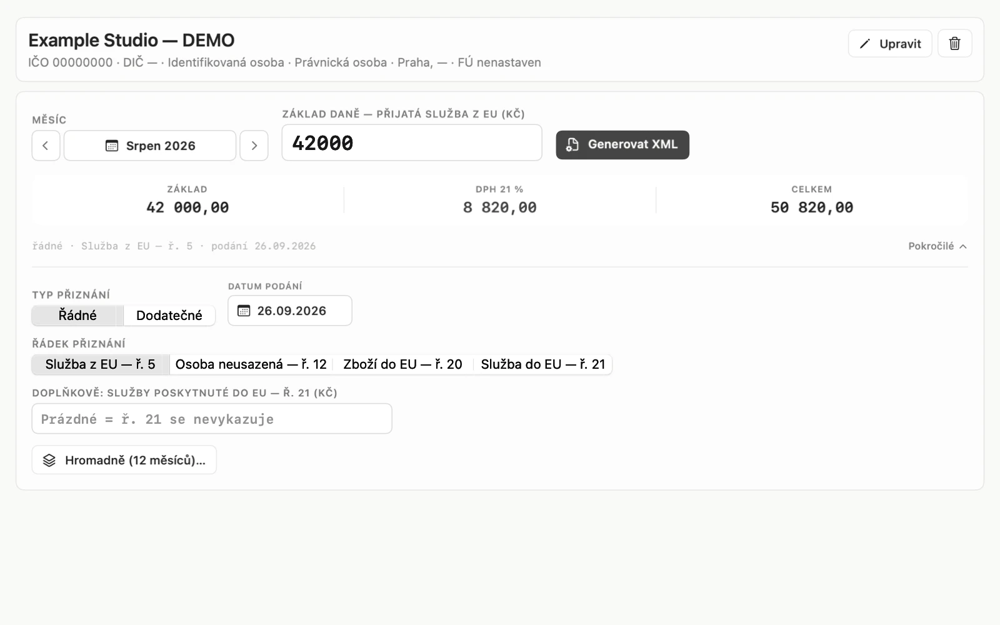
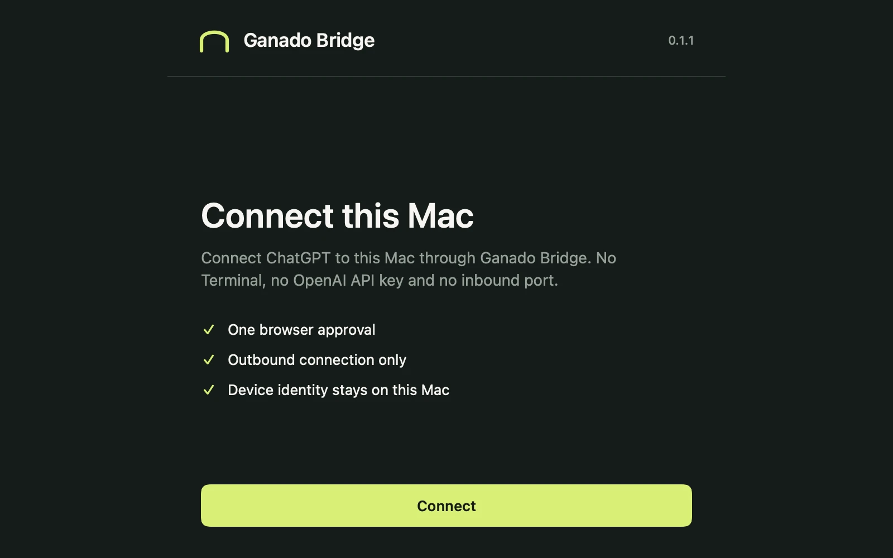
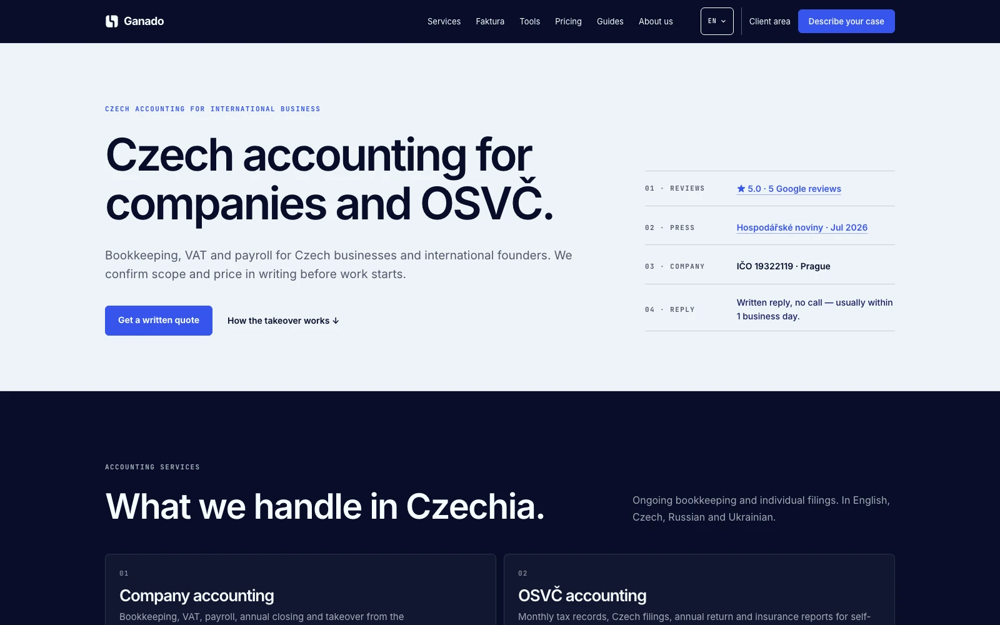

  

# Artem Chagin

**Financial software. Native macOS applications. AI integrations.**

I design, build and operate software for business workflows. I'm co-founder and CTO of **[Ganado](https://ganado.cz/en/)**, a Czech accounting and tax company — and I build the tools used alongside its client work.

**[Reliability Layer](https://reliabilitylayer.com)** brings together my products, engineering work and project enquiries.

[Portfolio](https://reliabilitylayer.com) · [About me](https://reliabilitylayer.com/artem-chagin) · [LinkedIn](https://www.linkedin.com/in/artemchagin/) · [Discuss a project](https://reliabilitylayer.com/work-with-me)

## Selected work

<table>
<tr>
<td width="50%" valign="top">

<h3>Ganado Faktura</h3>

Company details, line items and payment information — brought together in an invoice editor with PDF output.

<strong>Public web application</strong>

<a href="https://faktura.ganado.cz/en/">Open Faktura ↗</a> · <a href="https://reliabilitylayer.com/work/faktura">Product &amp; engineering</a>

</td>
<td width="50%" valign="top">

<h3>Sable</h3>

A native macOS application and CLI for preparing, validating and packaging Czech reporting documents.

<strong>In-house application · Closed source</strong>

<a href="https://reliabilitylayer.com/work/sable">Explore Sable ↗</a>

</td>
</tr>
<tr>
<td width="50%" valign="top">

<h3>Ganado Bridge</h3>

Connect an AI client to files and commands on an authorized computer. Checked edits, command output and real exit states through MCP.

<strong>MIT local agent · Managed service in preview</strong>

<a href="https://github.com/cynarax/bridge-by-ganado">Source &amp; setup ↗</a> · <a href="https://reliabilitylayer.com/work/ganado-bridge">Product &amp; engineering</a>

</td>
<td width="50%" valign="top">

<h3>Ganado</h3>

The accounting business behind the software. Client work, documents and reporting requirements inform what I build.

<strong>Operating company · Czechia</strong>

<a href="https://ganado.cz/en/">Visit Ganado ↗</a> · <a href="https://reliabilitylayer.com/work/ganado">Inside the business</a>

</td>
</tr>
</table>

Product screenshots use demonstration data. Bridge's native client is shown as a technical preview. Public product pages do not imply open-source availability.

## Engineering, grounded in operations

My work spans product design, implementation, deployment and maintenance. I build around explicit inputs, document validation, readable failures and checks against actual outputs — not just a successful demo.

For a public implementation, start with **[Ganado Bridge](https://github.com/cynarax/bridge-by-ganado)**: [agent source](https://github.com/cynarax/bridge-by-ganado/tree/main/agent), [tests](https://github.com/cynarax/bridge-by-ganado/tree/main/tests), [security model](https://github.com/cynarax/bridge-by-ganado/blob/main/SECURITY.md) and [release boundaries](https://github.com/cynarax/bridge-by-ganado/blob/main/RELEASE_STATUS.md).

## Work with me

I take on selected software and automation projects. Send the problem, the systems involved and what needs to change. I review the brief and reply by email; scope and the first paid stage are agreed before implementation.

**[Write a project brief ↗](https://reliabilitylayer.com/work-with-me)** · [artem@reliabilitylayer.com](mailto:artem@reliabilitylayer.com)

Czechia · Working internationally · English & Czech
